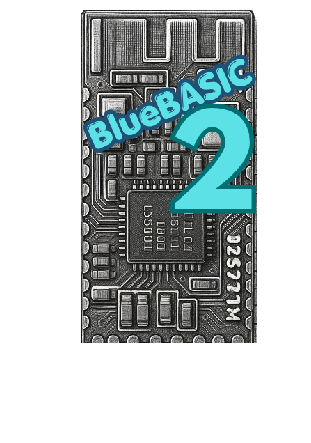

# BlueBASIC-2



> **BlueBASIC-2** is a modernized, highly enhanced fork of the original [BlueBASIC by aanon4](https://github.com/aanon4/BlueBasic). It transforms Texas Instruments CC2540 and CC2541 Bluetooth Low Energy (BLE) microcontrollers into standalone, self-hosted BASIC microcomputers featuring true hardware peripheral control, crystal-less operation, dedicated serial telemetry, and native hardware I2C.

---

## 🌟 About BlueBASIC-2

Original BlueBASIC was created by [Tim Wilkinson (aanon4)](https://github.com/aanon4/BlueBasic) as an open-source BASIC interpreter for TI CC254x BLE chips. 

**BlueBASIC-2** represents a comprehensive overhaul and modernization of the firmware, specifically engineered for inexpensive, widely available CC2540 and CC2541 modules (such as **HM-10**, **AT-09**, **JDY-08**, and custom hardware boards). It addresses critical hardware limitations of the original firmware—such as reliance on expensive external 32 kHz quartz crystals, hardcoded pinouts, and missing peripheral drivers—delivering a plug-and-play development experience directly through standard serial terminals.

---

## 🚀 Key Enhancements & New Features

### 1. ⏱️ 32 kHz Crystal-Less Operation (Internal RCOSC Calibration)
* **Runs on cheap modules without an external 32.768 kHz quartz crystal:** Stock BlueBASIC and standard TI BLE stacks hung at startup if an external 32 kHz crystal was missing.
* **Calibrated Internal RCOSC:** BlueBASIC-2 automatically initializes the internal 32 kHz RC Oscillator (RCOSC) and links it with dynamic calibration against the high-frequency 32 MHz crystal oscillator.
* Works seamlessly out of the box on low-cost **HM-10 clones, AT-09, JDY-08, and CC2541 breakout boards**.

### 2. 🔌 Dedicated HM-10 UART Pinout & Terminal Compatibility
* UART has been routed to the standard HM-10 dedicated communication pins:
  * **RX:** `P1_7` (USART1 Alt 2) / `P0_2` (USART0 Alt 1)
  * **TX:** `P1_6` (USART1 Alt 2) / `P0_3` (USART0 Alt 1)
* Default speed: **9600 baud, 8-N-1** (8 data bits, no parity, 1 stop bit, no flow control).
* Clock-halt divider disabled (`HCI_EXT_DISABLE_CLK_DIVIDE_ON_HALT`) ensuring zero baud-rate drift during radio operations.
* **Interactive Prompt:** Supports full backspace handling (`0x08` / `0x7F`), character echoing, command line editing, and paste buffering.
* **Tested & Verified Terminals:**
  * **PC Terminals (Windows / macOS / Linux):**
    * **Tera Term** *(Recommended — support character delay: 5 ms, line delay: 100 ms for script uploads)*
    * **PuTTY** *(Fully functional for interactive typing)*
    * **CoolTerm**
    * **RealTerm**
    * **HTerm**
    * **Arduino IDE Serial Monitor** *(Set to Both NL & CR, 9600 baud)*
  * **Mobile & Tablet Terminals (Android / iOS):**
    * **Serial Bluetooth Terminal** *(by Kai Morich — Android USB-OTG & Bluetooth BLE)*
    * **nRF Connect for Mobile** *(Nordic Semiconductor)*
    * **BLE Scanner / LightBlue**

---

### 3. ⚡ Native Hardware I2C Subsystem (`HWI2C`)
BlueBASIC-2 adds a dedicated, high-speed Hardware I2C Master controller driver for CC2541:
* **Dedicated Pins:** **Pin 2 (`SCL`)** and **Pin 3 (`SDA`)**.
* **Features:**
  * Programmable speeds: `33 kHz` (Low-speed), `100 kHz` / `123 kHz` (Standard), and `400 kHz` / `533 kHz` (Fast mode).
  * True hardware clock-stretching support, repeated START generation, combined write-then-read bursts, and bus-lock recovery.
* **Tested & Verified Hardware Devices on Real CC2541 Hardware:**
  | Hardware / Sensor | Description | I2C Address (7-bit / Wire) | Verified Features |
  | :--- | :--- | :--- | :--- |
  | **AHT10 / AHT20** | High-precision Temperature & Humidity Sensor | `0x38` (56) | Calibration check, trigger command, 6-byte burst read |
  | **DS3231** | High-Precision Real-Time Clock (RTC) | `0x68` (208 / `0xD0`) | BCD time read/write, temperature register read |
  | **AT24C32** | 32Kbit Serial I2C EEPROM Storage | `0x57` (174 / `0xAE`) | 16-bit address write, page read & write |
  | **BMP280** | Barometric Pressure & Altitude Sensor | `0x76` (238 / `0xEE`) | 24-byte calibration burst, 6-byte raw data read |
  | **PCF8574 / PCF8574T** | 1602 / 2004 Character LCD I2C Backpack | `0x3F` (63) or `0x27` (39) | 4-bit nibble command & character writes |

---

### 4. 🎛️ New Commands & Language Features

BlueBASIC-2 introduces new commands and extends the core language:

* **Hardware I2C (`HWI2C`):**
  * `HWI2C MASTER [speed]` — Initialize CC2541 hardware I2C master.
  * `HWI2C WRITE <address>, <byte1>, <byte2>, ...` — Write sequential bytes.
  * `HWI2C READ <address>, <var> | <dim_array>` — Read bytes into variable or array.
  * `HWI2C WRITE <address>, <reg>, READ <var> | <dim_array>` — Combined write-read repeated-START transaction.
* **Software Bit-Banged I2C (`I2C`):**
  * Coexists with `HWI2C` on arbitrary GPIO pins.
* **Hardware Timer 1 Servo PWM:**
  * Dedicated 16-bit 50 Hz PWM on **`P0_0`** with sub-microsecond pulse-width resolution.
* **Direct Hardware Edge Interrupts (`INTERRUPT`):**
  * Asynchronous interrupt triggers on rising/falling edge for real-time sensor events.
* **Flash Program Memory Management:**
  * Direct execution and storage in flash pages (`0x9000`+).
  * Commands: `LIST`, `NEW`, `SAVE`, `LOAD`, `ERASE`, `AUTORUN`.

---

### 5. 🛠️ Critical Bug Fixes & Stability Improvements

1. **Eliminated Startup Crystal Lock:** Fixed an infinite loop where the OSAL clock initialization froze waiting for an external 32.768 kHz crystal.
2. **UART Buffer Protection:** Added ring-buffer safety checks and pacing guidelines to prevent dropped characters when transferring multi-line BASIC source files.
3. **Interactive Line Editing:** Fixed backspace (`0x08` / `0x7F`) behavior and ANSI escape sequence parsing so terminal text doesn't corrupt.
4. **I2C Bus Lock Protection:** Added hardware timeout logic in `HWI2C` to prevent infinite hangs if an I2C slave fails to acknowledge (NACK) or lines are disconnected.
5. **Clock Stability under BLE Load:** System clock down-clocking during radio sleep is inhibited while interactive serial sessions are active.

---

## 📌 Tested Hardware Setup & Pinout Reference

Verified on a CC2541 hardware test rig with the following standard pin allocation:

| Function | Pin / Port | Hardware Description |
| :--- | :--- | :--- |
| **Serial RX** | `P1_7` (or `P0_2`) | Connect to USB-UART TX (3.3V logic) |
| **Serial TX** | `P1_6` (or `P0_3`) | Connect to USB-UART RX (3.3V logic) |
| **HWI2C SCL** | **Pin 2** | Dedicated CC2541 Hardware I2C Clock (4.7 kΩ pullup) |
| **HWI2C SDA** | **Pin 3** | Dedicated CC2541 Hardware I2C Data (4.7 kΩ pullup) |
| **Blue LED** | `P1_2` | Active HIGH (470 Ω to GND) |
| **Green LED** | `P0_7` | Active HIGH (470 Ω to GND) |
| **Switch 1 (SW1)** | `P1_3` | Push-button to GND via 1 kΩ (10 kΩ pullup) |
| **Switch 2 (SW2)** | `P0_5` | Push-button to GND via 1 kΩ (10 kΩ pullup) |
| **Servo 1 Signal**| `P0_0` | Hardware Timer 1 PWM (50 Hz RC Servo Signal) |

---

## 📥 Flashing BlueBASIC-2

BlueBASIC-2 can be flashed onto target CC2540/CC2541 chips using a low-cost **Arduino Uno** running `CCLoader.ino` — no expensive CC Debugger required!

### Arduino Uno to CC254x Debug Port Wiring
* **Arduino Pin 4** ➡️ **CC254x Pin 4 (DD / Debug Data)**
* **Arduino Pin 5** ➡️ **CC254x Pin 3 (DC / Debug Clock)**
* **Arduino Pin 6** ➡️ **CC254x Pin 5 (RESET_N)**
* **Arduino GND**   ➡️ **Target GND**
* **Arduino 3.3V**  ➡️ **Target VCC (3.3V)** *(Ensure 3.3V logic level compliance)*

### Flashing via CCLoader
```powershell
# Flash BlueBasic.bin onto Device 0 via Arduino Uno on COM2
CCLoader.exe 2 BlueBasic.bin 0
```
> [!NOTE]
> Keep **COM1** exclusively for your BlueBASIC interactive serial telemetry link (9600 baud). Never flash through the telemetry port.

---

## 💻 Example BlueBASIC-2 Programs

### 1. Dual LED Blinky
```basic
10 REM Dual LED Flasher (Blue P1_2 = Pin 18, Green P0_7 = Pin 7)
20 PIN 18, 1 : PIN 7, 1
30 PIN 18, 1 : PIN 7, 0 : DELAY 500
40 PIN 18, 0 : PIN 7, 1 : DELAY 500
50 GOTO 30
RUN
```

### 2. AHT10 / AHT20 Temperature & Humidity Reader (`HWI2C`)
```basic
10 REM Read AHT20 Temperature via HWI2C (Address 0x38 = 56)
20 HWI2C MASTER 100
30 HWI2C WRITE 56, 172, 51, 0
40 DELAY 120
50 DIM D(6)
60 HWI2C READ 56, D
70 PRINT "AHT20 STATUS BYTE: "; D(0)
80 PRINT "RAW HUMIDITY: "; D(1); ", "; D(2); ", "; D(3)
90 PRINT "RAW TEMP: "; D(3); ", "; D(4); ", "; D(5)
100 DELAY 1000
110 GOTO 30
RUN
```

### 3. DS3231 RTC Time Reader (`HWI2C`)
```basic
10 REM Read Seconds, Minutes, Hours from DS3231 (Address 104 / 0x68)
20 HWI2C MASTER 100
30 DIM T(3)
40 HWI2C WRITE 104, 0, READ T
50 S = ((T(0) >> 4) * 10) + (T(0) & 15)
60 M = ((T(1) >> 4) * 10) + (T(1) & 15)
70 H = (((T(2) & 48) >> 4) * 10) + (T(2) & 15)
80 PRINT "TIME: "; H; ":"; M; ":"; S
90 DELAY 1000
100 GOTO 40
RUN
```

---

## 📂 Project Structure

```text
..\BlueBASIC\
│
├── README.md                                  # This document
├── bluebasic2.png                             # BlueBASIC-2 project banner logo
│
├── BLE-CC254x-1.4.0\                          # TI BLE Stack v1.4.0 base
│   └── Projects\ble\BlueBasic\                # Firmware Source & Working Directory
│       ├── Source\                            # C source files, OSAL drivers, interpreter engine
│       │   ├── main.c                         # System initialization & RCOSC setup
│       │   ├── osal_bluebasic.c               # OSAL task loops and events
│       │   ├── hwi2c.c                        # Dedicated CC2541 Hardware I2C driver
│       │   └── ...
│       └── Build\                             # IAR Embedded Workbench project (BlueBasic.ewp)
│
├── Examples\                                  # Complete library of ready-to-run *.bas scripts
│   ├── blink.bas
│   ├── aht20_sensor.bas
│   ├── ds3231_rtc.bas
│   ├── lcd1602_pcf8574.bas
│   └── servo_pwm.bas
│
└── help\                                      # Detailed documentation and hardware guides
    ├── BLUEBASIC_COMMANDS_REFERENCE.md        # Comprehensive BASIC syntax & command guide
    ├── SERIAL_COMMUNICATION_GUIDE.md          # Terminal configuration guidelines
    └── SERIAL_COMMUNICATION_TEST_REPORT.md    # Real hardware validation test log
```

---

## 📜 Credits & License

* **BlueBASIC-2:** Enhanced, patched, and maintained for CC2540/CC2541 hardware modules.
* **Original BlueBASIC Author:** [Tim Wilkinson (aanon4)](https://github.com/aanon4/BlueBasic) — original author of BlueBASIC.
* **Stack:** Texas Instruments BLE-CC254x-1.4.0 OSAL Stack.
* **License:** Released under the original BlueBASIC open-source licensing terms (see `LICENSE`).
